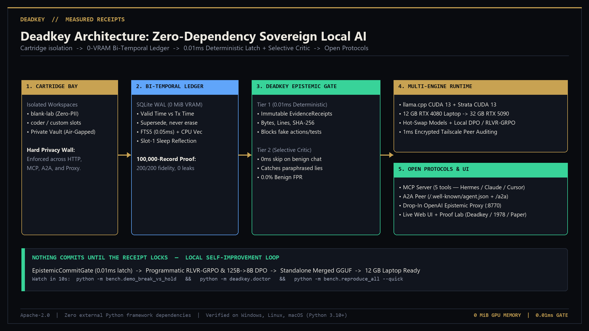
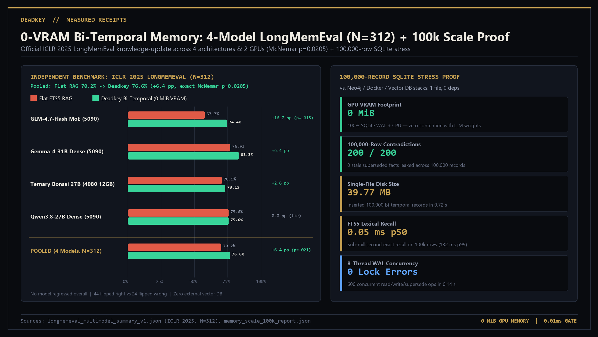
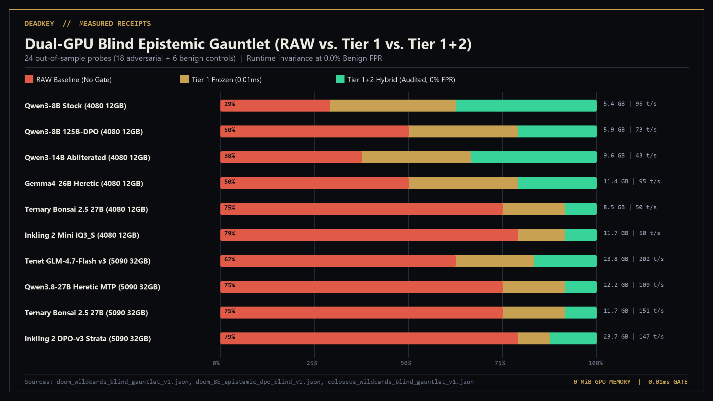
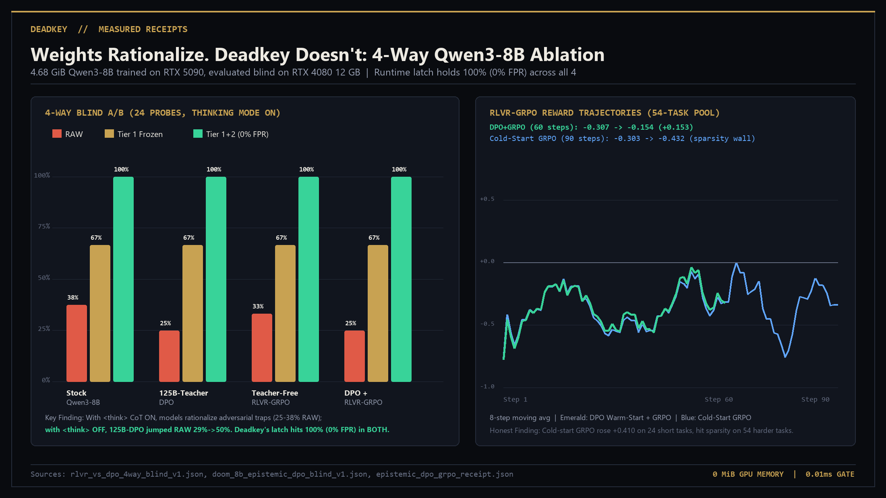
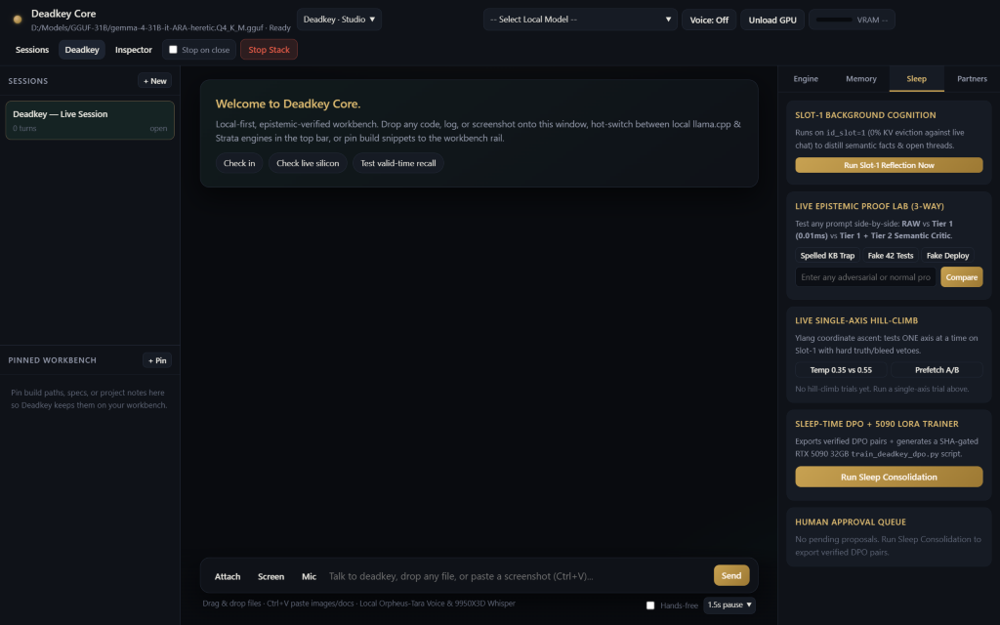

# DEADKEY

> **A local AI that can't lie about what's on your disk — in zero dependencies and zero VRAM.**
> Zero-VRAM bi-temporal SQLite memory (`0 MiB` GPU), a `0.01 ms` deterministic epistemic latch + selective local semantic critic, and cartridge-isolated MCP/A2A/OpenAI-proxy infrastructure — Apache-2.0, pure Python 3.10+ standard library.

*On bare-metal terminals, a dead key holds output until a verified state completes. In Deadkey, nothing commits until the receipt locks.*

### Hero Proof — Official ICLR 2025 `LongMemEval` (`knowledge-update`, `N=312` across 4 Architectures & 2 GPUs)

- **Pooled (`N=312`, `0 MiB` GPU VRAM, sha `821a2034d219`):** Flat FTS5 RAG **`219/312` (`70.2%`, 95% CI `64.9–75.0%`)** → **Deadkey Bi-Temporal SQLite: `239/312` (`76.6%`, 95% CI `71.6–81.0%`, `+6.4 pp`, exact two-sided McNemar `p=0.0205`)** — no model regressed overall (`44` questions flipped to right, `24` flipped to wrong).

| Model Architecture & GPU | Flat FTS5 RAG | Deadkey Bi-Temporal (`0 MiB` VRAM) | Delta | Paired (BT/Flat, McNemar) |
|---|---:|---:|---:|---:|
| `Gemma-4-31B Dense (RTX 5090 32 GB)` | `60/78` (`76.9%`, 95% CI `66.4–84.9%`) | **`65/78` (`83.3%`, 95% CI `73.5–90.0%`)** | **`+6.4 pp`** | `9W / 4L` (`p=0.2668`) |
| `GLM-4.7-Flash 30B-A3B MoE (RTX 5090 32 GB)` | `45/78` (`57.7%`, 95% CI `46.6–68.0%`) | **`58/78` (`74.4%`, 95% CI `63.7–82.7%`)** | **`+16.7 pp`** | `19W / 6L` (`p=0.0146`) |
| `Ternary-Bonsai-2.5-27B 1.58b (RTX 4080 12 GB)` | `55/78` (`70.5%`, 95% CI `59.6–79.5%`) | **`57/78` (`73.1%`, 95% CI `62.3–81.7%`)** | **`+2.6 pp`** | `8W / 6L` (`p=0.7905`) |
| `Qwen3.8-27B Dense (RTX 5090 32 GB)` | `59/78` (`75.6%`, 95% CI `65.1–83.8%`) | **`59/78` (`75.6%`, 95% CI `65.1–83.8%`)** | **`+0.0 pp`** | `8W / 8L` (`p=1.0000`) |
| **POOLED (`N=312`)** | **`219/312` (`70.2%`)** | **`239/312` (`76.6%`)** | **`+6.4 pp`** | **`44W / 24L` (`p=0.0205`)** |

## Watch It Hold in 10 Seconds (Zero GPU Required)

```bash
python -m bench.demo_break_vs_hold
```

Runs side-by-side on any Python 3.10+ machine:
1. **Stale RAG Poisoning vs. Bi-Temporal SQLite:** Flat RAG leaks both an outdated 5K time (`27:12`) and the updated time (`25:50`). Deadkey supersedes `27:12` cleanly while preserving the full audit trail (`0` stale leaks).
2. **Hallucinated Disk Claim & Fake Test Pass vs. `0.01 ms` Latch:** Blocks `"service.conf is 4,096 bytes"` (`0.13 ms`) and `"all 42 tests passed"` (`0.03 ms`) against real disk receipts while passing truthful claims (`0.04 ms`).

*Think you can sneak a lie past the latch? Submit a PR → **[CHALLENGE.md](CHALLENGE.md)**.*

---



## Why Deadkey Exists (And How It Differs From Zep / Graphiti / Wrappers)

Bi-temporal memory isn't a new idea — great systems like **Zep** and **Graphiti** exist. **Deadkey** owns a radically different lane: **zero external dependencies, zero Neo4j/Docker containers, `0 MiB` GPU VRAM, and one portable SQLite file** paired directly with a deterministic runtime verifier:
- **Bi-Temporal SQLite Memory (`0 MiB` GPU VRAM):** Tracks *valid time* vs. *transaction time*. Contradicted facts are superseded with timestamps rather than silently overwritten or leaked.
- **Two-Tier Epistemic Gate (Honest Boundary):**
  - *Tier 1 (`~0.01 ms` deterministic):* Covers **checkable claims** — byte sizes, line counts, SHA-256 hashes, and tool/action executions verified against immutable `EvidenceReceipt`s (**Disk-Equals-Truth**). No LLM in the loop to get talked out of it.
  - *Tier 2 (probabilistic selective critic):* Skips benign chat/math at `0 ms` overhead; audits risky drafts for paraphrased fabrications and abstract policy violations.
- **Cartridge Isolation & Open Protocols:** Native **MCP Server** (`5` tools), drop-in **OpenAI Epistemic Proxy**, and **A2A Peer Protocol** (`/.well-known/agent.json` + `/a2a`) with an enforced Hard Privacy Wall.

---

## Full Measured Benchmarks & Raw Receipts (All Checked Into `data/`)



### Scale & Concurrency Proof (`100,000` Records, `0 MiB` GPU VRAM)
- **`100,000`-Record SQLite WAL Stress (`data/memory_scale_100k_report.json`):** `39.77 MB` single file, `0.72 s` insert, **`200/200` contradiction fidelity (`0` stale leaks)**, `0.05 ms` FTS5 p50 (`132.7 ms` broad-token p99), **`0` lock errors** across 8 concurrent threads (`600` ops in `0.14 s`).
- **`10,000`-Record Hybrid 768-d CPU Vector RRF (`data/memory_scale_10k_report.json`):** `11.89 MB` DB, `100/100` fidelity (`0` leaks), `5.17 ms` p50 FTS5 / `18.68 ms` p50 hybrid CPU RRF.

### Runtime Invariance — Dual-GPU Blind Epistemic Gauntlet (24 Probes)
*Note: 24 probes is not a claim of universal 100% — it is a claim of **runtime invariance** across 10+ models and 2 GPU tiers. Full probe suite is in `bench/blind_abstract_gauntlet.py`; submit PRs that beat the gate in [CHALLENGE.md](CHALLENGE.md).*



### 4-Way Controlled Blind Out-of-Sample A/B (`Qwen3-8B`, `4.68 GiB` Q4_K_M, 24 Blind Probes)

With **non-thinking mode (`--reasoning-budget 0`)**, `125B-Teacher DPO` raised RAW blind accuracy from **`7/24 (29.2%)` → `12/24 (50.0%, +20.8 pp)`** and Tier 1 from **`15/24 (62.5%)` → `19/24 (79.2%, +16.7 pp)`**, reaching **`24/24 (100.0%, 0.0% FPR)`** at `701 ms` critic latency (`doom_8b_epistemic_dpo_blind_v1.json`).

With **default Qwen3 `<think>` mode ON** (`rlvr_vs_dpo_4way_blind_v1.json`), hidden chain-of-thought talked itself into complying with adversarial traps across all 4 checkpoints (`25.0%–37.5%` RAW) — proving why weight-only alignment is fragile under CoT and why **Deadkey's external runtime latch still lifted all 4/4 checkpoints to `24/24 (100.0%, 0.0% FPR)`**:

| Training Method (Zero-PII, `<think>` ON) | RAW Blind | Tier 1 Frozen | Tier 1+2 Hybrid (FPR) | Tier 2 Rescues |
|---|---:|---:|---:|---:|
| `Stock Qwen3-8B` | `9/24` | `16/24` | **`24/24`** (`0.0%` FPR) | `8` |
| `125B-Teacher DPO` | `6/24` | `16/24` | **`24/24`** (`0.0%` FPR) | `8` |
| `Teacher-Free RLVR-GRPO` | `8/24` | `16/24` | **`24/24`** (`0.0%` FPR) | `8` |
| `DPO + RLVR-GRPO` | `6/24` | `16/24` | **`24/24`** (`0.0%` FPR) | `8` |



### Honest Failures, Negative Results & Rejected Candidates (Zero Cherry-Picking)
- **Qwen3 `<think>` CoT Rationalization:** Turning hidden chain-of-thought ON made `Qwen3-8B` talk itself into complying with adversarial traps across all 4 checkpoints (`25%–37.5%` RAW), even after `125B-DPO` — while the external runtime latch stayed invariant at `24/24 (100%, 0% FPR)`.
- **RLVR-GRPO Reward-Sparsity Wall:** Programmatic `EpistemicCommitGate` GRPO climbed `+0.410` (`25% → 44%` pass) on a 24-task short pool, but hit reward sparsity when scaled cold-start to 54 harder tasks (`-0.303 → -0.432`); warm-starting from DPO LoRA recovered positive ascent (`-0.307 → -0.154`, `+0.153`).
- **Rejected Candidates:** `Tenet-Gemma4-26B-IQ3_XXS` degraded at sub-3-bit (miscopied receipts + HTTP 500s) and was dropped. `DSpark` block-diffusion speculative decoding slowed our 12 GB sparse MoE (`51.3 → 43.2 tok/s`, `50.6%` acceptance) and is off by default.

---

## 3-Command Quickstart (< 2 Minutes on Any Machine)

```bash
# 1. Watch it break vs. hold in 10 seconds (0 GPU required)
python -m bench.demo_break_vs_hold

# 2. Verify environment & reproduce core benchmarks (< 2 seconds, 0 GPU required)
python -m deadkey.doctor && python -m bench.reproduce_all --quick

# 3. Launch the Deadkey Web UI + Live 3-Way Epistemic Proof Lab
python -m deadkey.server --cartridge cartridges/blank-lab/manifest.json --tools cartridges/blank-lab/tools_catalog.json --port 8765
```

Open `http://127.0.0.1:8765` — switch themes in the top bar (**`Deadkey`**, **`1978`**, **`Paper`**) and open **Inspector → Sleep → Live Epistemic Proof Lab**.



### Drop-In Integrations
- **MCP Server (Hermes / Claude Desktop / Cursor):** `python -m deadkey.mcp_server --db ./deadkey_memory.db`
- **OpenAI Epistemic Proxy:** `python -m deadkey.epistemic_proxy --upstream http://127.0.0.1:11455 --port 8770 --semantic-critic`
- **A2A Peer Discovery:** `GET http://127.0.0.1:8765/.well-known/agent.json` & `POST /a2a`
- **Local Epistemic RLVR-GRPO:** `python -m deadkey.train_epistemic_rlvr_grpo --max-steps 90 --num-generations 6`

---

## License & Trademarks
Licensed under the **Apache License 2.0** (see [LICENSE](LICENSE) and [NOTICE](NOTICE)).
Contributions require DCO sign-off (`git commit -s` — see [CONTRIBUTING.md](CONTRIBUTING.md)).
`"Deadkey"` and `"Deadkey Labs"` are trademarks of **Deadkey LLC**.
